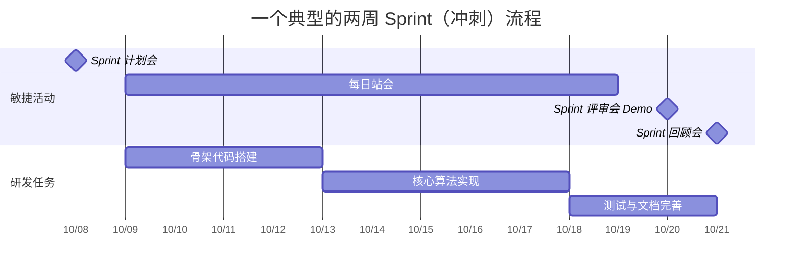
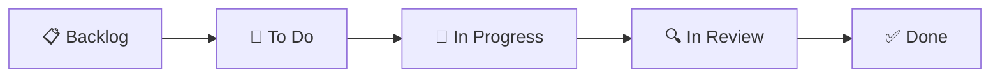

# 1. 制定沟通管理计划

| 沟通内容 | 沟通频度 | 沟通方式 | 产出物 |
| ------------ | ------------ | ------------ | ------------ |
|  | |  |  |


注意事项：
- 条目的顺序可根据生命周期：分析、设计、开发、测试、发布、运行维护
- 沟通内容的粒度不能太粗，也不能太细，可写出每个生命周期需要沟通的主题
- 沟通频度：即时、每天、每周、每月等
- 沟通方式包括：邮件、电话、即时通信工具、视频会议、面对面交流、项目协作平台（项目仓库）
- 产出物包括文档（含产品设计、技术设计方案、开发测试维护中常见问题原因和解决方法等）、代码、达成一致的工作方式等。

# 2. 制定风险管理计划

说明：风险是指存在不确定的问题。 
单个风险：一旦发生，会对一个或多个项目目标产生正面或负面影响的不确定事件或条件。 
整体项目风险：不确定性对项目整体的影响，是相关方面临的项目结果正面和负面变异区间。它源于包括单个风险在内的所有不确定性。

制定风险管理计划的目标是提高正面风险的概率和或影响，降低负面风险的概率和或影响，提高项目成功的可能性。

| 风险名称 | 所属维度（如资源、项目管理、外部因素、技术、进度） | 风险说明 | 影响程度（重要性） | 对工作量的影响（高、中、低） | 对进度和成本的影响（高、中、低） | 优先权（紧急程度） | 跟踪频率 |
| ------------ | ------------ | ------------ | ------------ | ------------ | ------------ | ------------ | ------------ | 
|  |  |  |  |  |  |  |  | 


# 敏捷开发方法 (Agile Methodology)
### 针对科学研究与不确定性项目的轻量级管理

创新项目往往面临“不确定性”，传统的瀑布模型无法适应，推荐使用 **Scrum / Kanban**。



- **Product Backlog**：所有想做的功能池。
- **Sprint Backlog**：本周期（通常2周）承诺完成的任务。
- **定义完成 (Definition of Done, DoD)**：例如“代码通过单元测试，分支合并入 `develop` 且文档已更新”才算完成。
- 参考 [敏捷开发](https://github.com/bettermorn/IntelligentSWEPractice/wiki/%E3%80%90%E5%B7%A5%E7%A8%8B%E6%96%B9%E6%B3%95%E8%AE%BA%E3%80%91%E6%95%8F%E6%8D%B7%E5%BC%80%E5%8F%91)


# Scrum的精髓

- SCRUM使得我们能够专注于如何在**最短**的时间内实现**最有价值**的部分。
- SCRUM使得我们能够快速地经常地监督实际产品发展的状况.（每两周或一个月）
- 团队按照**商业价值**的高低先完成高优先级的产品功能，并自主管理，凝结了团队智慧创造出最好的方法因而提高效率。
- 每隔一两周或者一个月，我们就可以看到实实在在的可以上线的产品。此时，就可以下一步的决定是继续完善功能实现更多需求或者直接发布了。


# 使用GitHub做Scrum

Scrum 需要三类支撑：**可视化流程 / 迭代计划 / 缺陷追踪**


| Scrum 要素 | GitHub 对应功能 |实现目标|
|---|---|---|
| Sprint Backlog 可视化 | **Projects (Kanban Board)** |可视化Sprint执行状态|
| Sprint / 里程碑规划 | **Milestones + Team Planning** |支持Sprint计划与评审|
| 缺陷与任务追踪 | **Issues (Bug Tracker)** |缺陷与任务统一入口|


- GitHub **代码、任务、缺陷同源**，减少上下文切换

- Scrum 的"计划—执行—追踪—复盘"全部在同一平台完成

* GitHub Projects 官方文档首页：https://docs.github.com/en/issues/planning-and-tracking-with-projects
* Projects 快速上手指南：https://docs.github.com/en/issues/planning-and-tracking-with-projects/learning-about-projects/quickstart-for-projects
* Projects 自动化设置：https://docs.github.com/en/issues/planning-and-tracking-with-projects/automating-your-project


# Kanban 看板：GitHub Projects

把 Sprint Backlog 转化为可拖拽的看板，列对应 Scrum 流程：



**实践要点：**
- 每张卡片 = 一个 Issue / PR，可挂 Story Points、标签（`feature`、`bug`、`chore`）
- 使用自动化规则：PR 合并 → 卡片自动移至 *Done*
- 燃尽图可借助 GitHub Insights 或第三方可视化插件生成，替代传统独立燃尽图工具


# Team Planning：迭代与里程碑

::left::

**Sprint Planning 对应操作：**
- 创建 **Milestone**（如 `Sprint-5`），设定起止日期
- 将本迭代 Issue 批量绑定到该 Milestone
- 使用 **Assignees** 明确任务负责人
- 结合 **GitHub Projects 视图（Table / Roadmap）** 做排期

::right::

**Daily / Review / Retro 支持：**
- Daily Standup：看板 *In Progress* 列即为站会素材
- Sprint Review：Milestone 进度条（已关闭/总数）自动统计
- Retro：用 Discussions 或专门 Issue 记录复盘要点

> GitHub Milestone 把计划与真实代码进度绑定。


# Bug Tracker：Issues 管理缺陷

**标准化流程：**

```yaml
# .github/ISSUE_TEMPLATE/bug_report.yml（简化示例）
name: Bug Report
labels: [bug]
body:
  - type: textarea
    attributes:
      label: 复现步骤
  - type: textarea
    attributes:
      label: 期望 vs 实际行为
  - type: dropdown
    attributes:
      label: 优先级
      options: [P0, P1, P2]
```

- 使用 **Labels**（`bug` / `priority:P0`）+ **Milestone** 定位缺陷所属 Sprint
- Bug 卡片同样进入 Kanban 看板，与功能任务统一排期
- PR 中 `Fixes #123` 语法自动关闭对应 Issue，形成闭环
